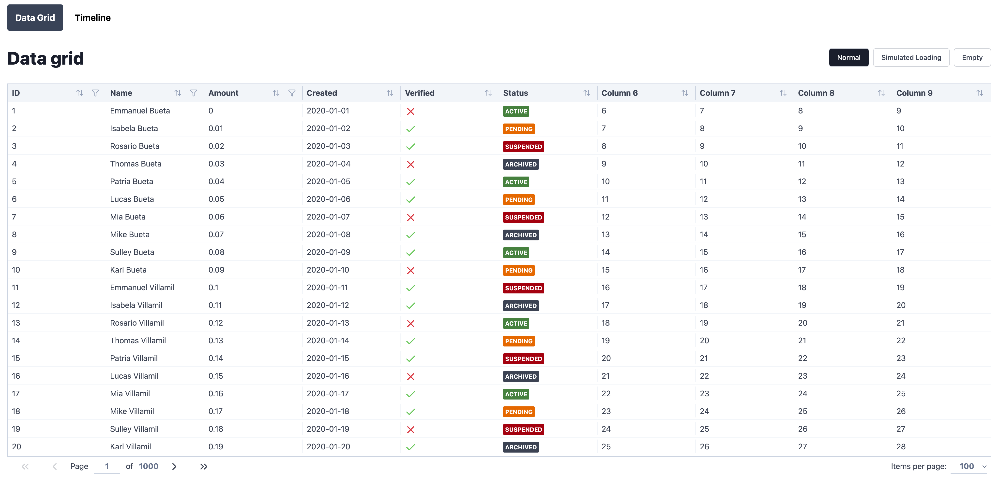
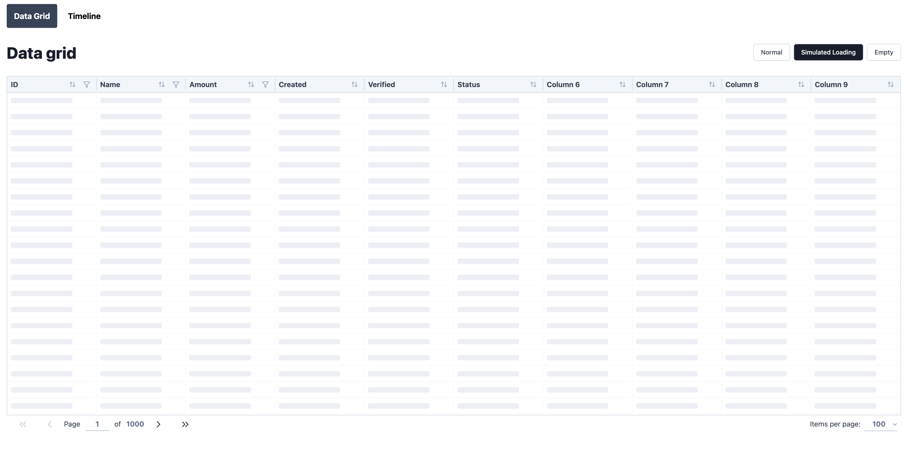
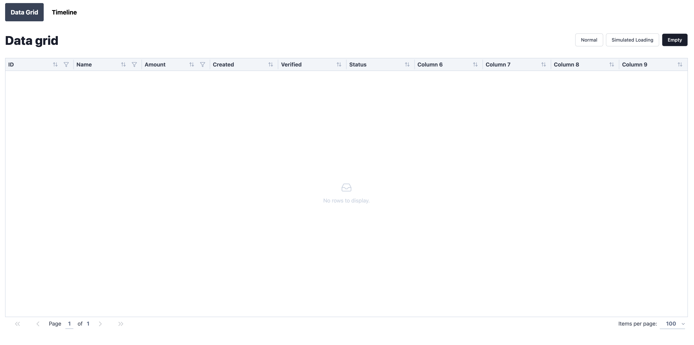
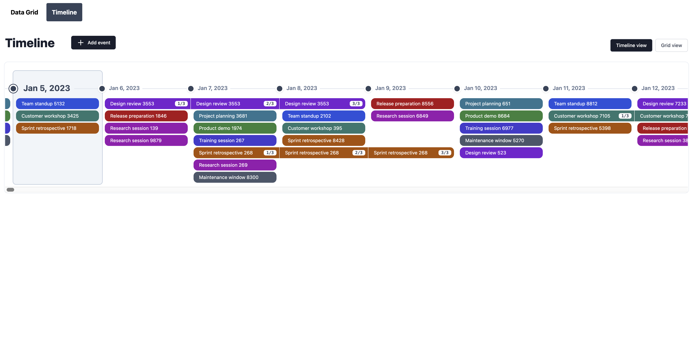
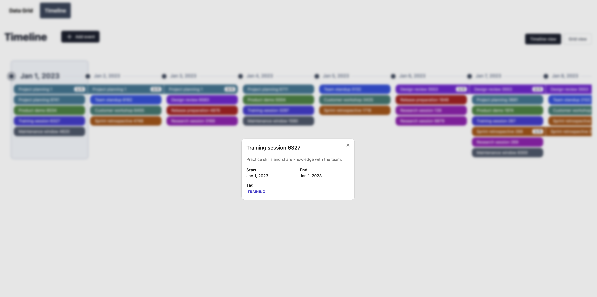
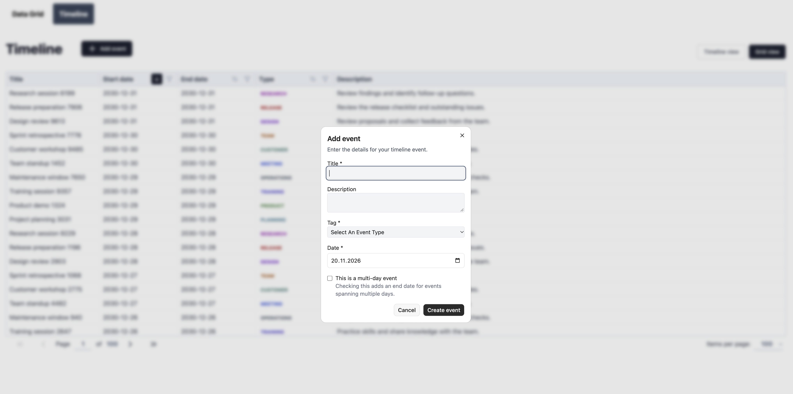
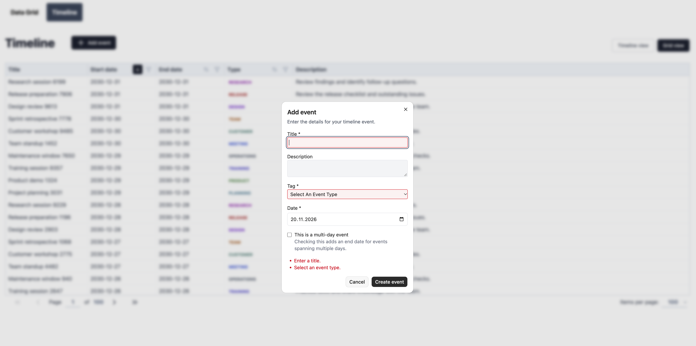
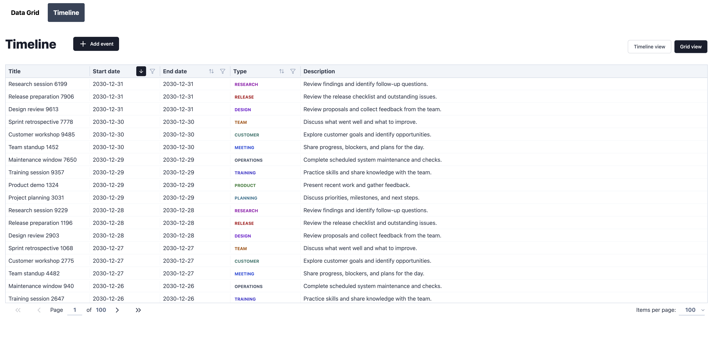

### Installation

at root 
`npm install`
`npm run dev --workspace=demo`

## Packages/Libraries used

# tailwind + tailwind typography

- for quick proto and minimize need for custom css classes

# @tanstack/react-virtual

- for virtualizing rows in datagrid / days in datagrid for optimization for larger data

# shadcdn

- for smaller incidental components - popover, dialog, button, toast
- shadcn data grid/table, timeline, pagination, datepicker etc not used (as they seem to be more crucial aspects of exercise)

## Notes

- mockdata.ts - used to programatically generate / populate with 100k mockdata rows
- public/events.json - mock data for timeline / events

### Demo Pages

Two main routes/pages Data Grid and Timeline.

## DataGrid

Route used to demo Data Grid component. Populated with 100_000 records.

- (misread initial instructions and thought we would need to render 100_000 rows x 10_000 columns) so built with chunking of data in mind - which adds a few extra unnecssary steps / tradeoffs. too late to pivot by the time i realized misreading.
  - container of data-grid needs to have fixed height - as it used the height to calculate what rows are visible / what / when to load
  - passing of data is unnatural / has additional steps (e.g. wrapping it together with a 'startRow')
  - as client-side sorting / filtering + pagination would only work if dataset is complete -- despite chunking of datablock semi-implemented by the time we do sorting/pagination/filtering we just return back to assumption taht we have whole data block in memory

# Functionalities

- Client Side Pagination, Sorting, Filtering
- can handle 100000 records
-  and  states -- error state missed.
- configurable columns - hide/show, label, acessor, sortable, filterable, sortingFn, renderFn

## Timeline

Route used to demo Timeline, Event Form and Data Grid as well (but with diff dataset, but less)

# Timeline Functionalities

- Event records grouped by day
- multi day events parsed and handled
- keyboard arrow keys navigable to switch between days / events. open wth enter.
- screen reader announcements on change of selected date / event

# Create Event

- Form for creating event with validations
- has 'tag' field which acts as flag for what type of event it is (to help with visual differentiation)

# Event Grid

- just another use of the data-grid so taht when event is created it will reflect on this as well (other data grid does not use event records)
